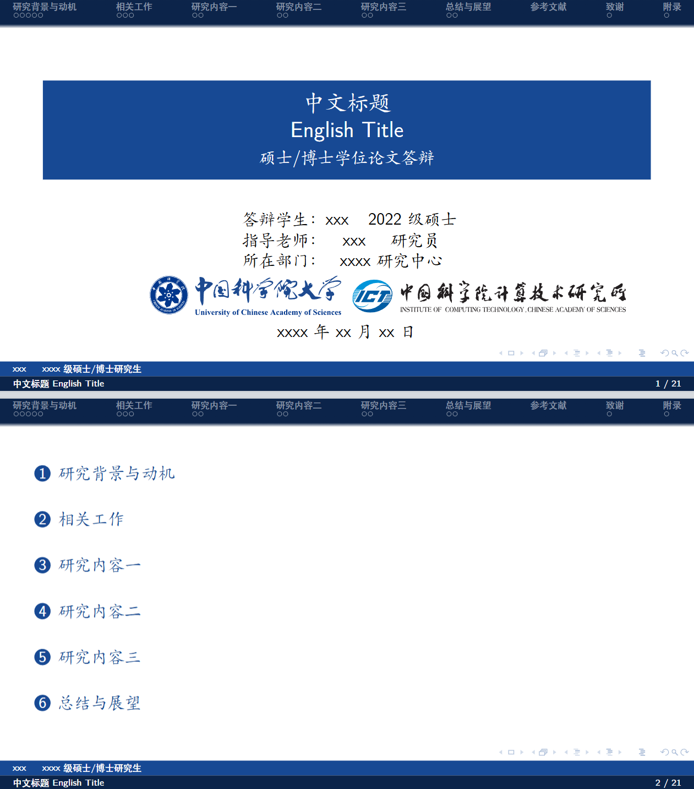

# ICT Beamer Theme

A Beamer Theme for the Institute of Computing Technology, CAS.

## Preview

下面是使用此模板生成的示例幻灯片截图 (`Img/Sample.png`)：



可以查看 `ICT_Beamer_Sample.pdf` 以获取更完整的示例文稿。

## 如何使用

### 依赖

*   一个支持 LaTeX 的环境。推荐使用 `xelatex` 引擎进行编译，以获得最佳的中文和字体支持。
*   在 Overleaf 或 ShareLaTeX 等在线平台，请确保将编译引擎设置为 `xelatex`。
*   确保已安装模板中使用的 LaTeX 宏包（详见 `main.tex` 的 `\\usepackage` 部分）。

### 编译

通常，直接编译 `main.tex` 文件即可。

对于本地环境，推荐使用 `xelatex`：

```bash
xelatex main.tex
```

如果包含参考文献 (`ref.bib`)，可能需要多次编译：

```bash
xelatex main.tex
bibtex main
xelatex main.tex
xelatex main.tex
```

在 Overleaf/ShareLaTeX 等平台上，通常会自动处理多次编译。

### 自定义

*   **基本信息**：在 `main.tex` 中修改以下内容：
    *   `\author[]{}`：修改答辩学生、指导老师、所在部门等。
    *   `\title{}`：修改中文和英文标题。
    *   `\subtitle{}`：修改副标题（如“硕士/博士学位论文答辩”）。
    *   `\date{}`：修改日期。
*   **内容**：
    *   演示文稿的主要内容分布在 `chapters/` 目录下的 `.tex` 文件中，例如 `Chap1_Intro.tex`, `Chap2_Related.tex` 等。
    *   参考文献在 `ref.bib` 中管理。
*   **主题与样式**：
    *   主题样式定义在 `ICT-theme.sty` 中。
    *   Logo 文件位于 `logos/` 目录，可以在 `ICT-theme.sty` 或 `main.tex` 中按需调整。

## 文件结构

```
.
├── ICT-theme.sty       # Beamer 主题文件
├── main.tex            # 主 LaTeX 文件
├── ref.bib             # 参考文献
├── chapters/           # 各章节内容
│   ├── Appendix.tex
│   ├── Chap1_Intro.tex
│   ├── Chap2_Related.tex
│   └── Chap6_Sum.tex
├── logos/              # Logo 文件
│   ├── ICT_logo.pdf
│   ├── ICT_onlylogo.pdf
│   ├── ucas_logo.pdf
│   └── UCAS_onlylogo.eps
└── README.md           # 本文件
```

## 致谢

本模板的开发参考了以下优秀项目：

*   [THU-Beamer-Theme](https://github.com/tuna/THU-Beamer-Theme/tree/master)
*   [UCAS-CASIA-Beamer-Theme](https://github.com/mashijie1028/UCAS-CASIA-Beamer-Theme)

感谢这些项目为本模板提供的灵感和参考。
