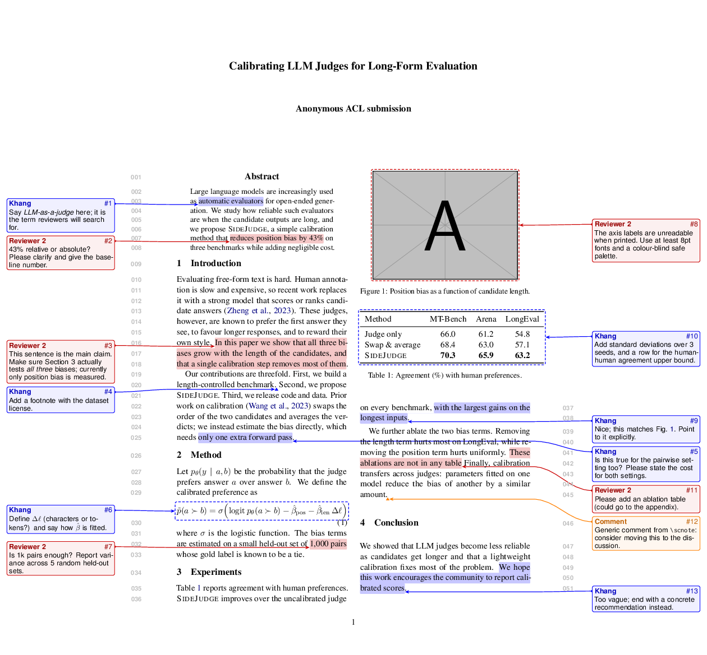
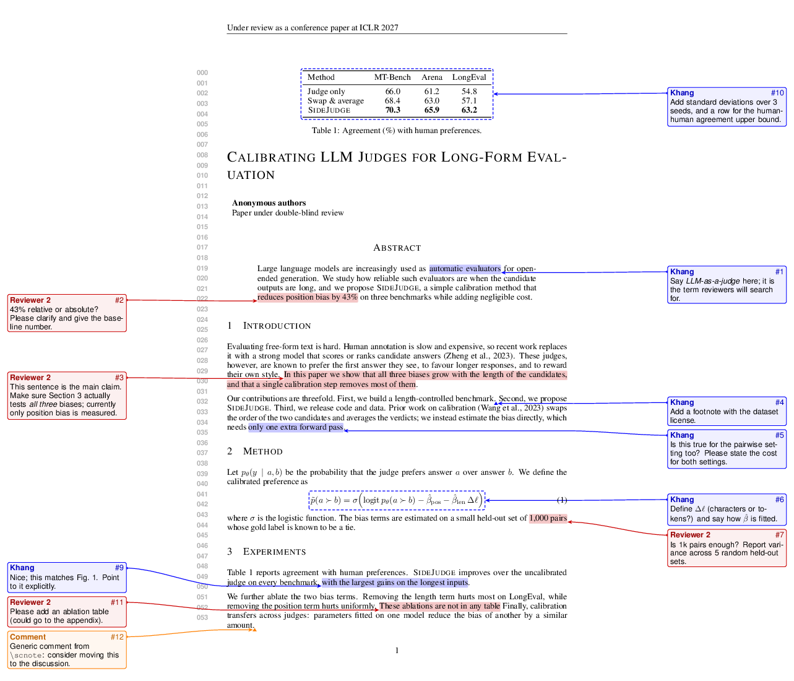
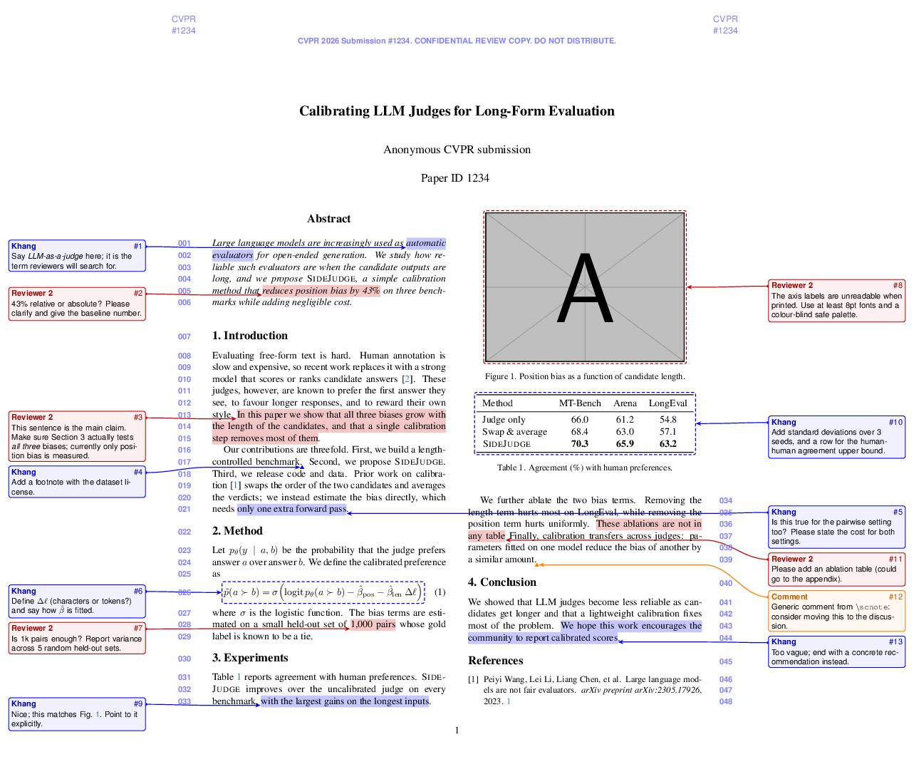
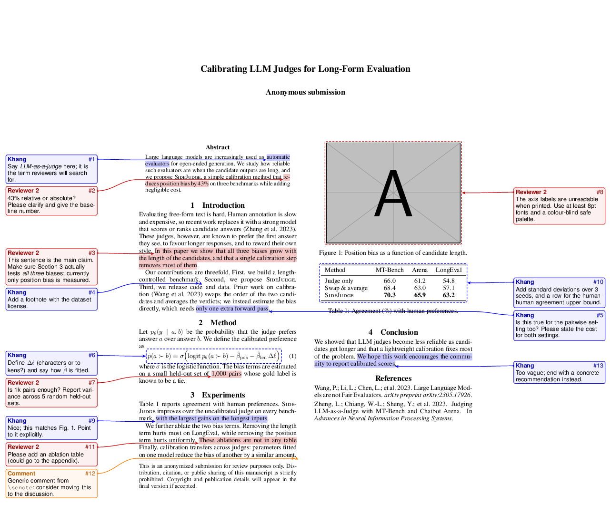

# sidecomments — see review comments in the PDF

A tiny LaTeX package that puts review comments **in boxes on both sides of the
page, with arrows pointing at the commented phrase, figure, table or
equation**. Nobody has to open the Overleaf comment panel: compile, and the
comments are in the PDF.

Note that the page is made wider, so the venue's layout (line numbers, rulers, columns,
page breaks) is left as it is. One option switches everything off for
submission.

| ARR (ACL) | ICLR | CVPR | AAAI |
|---|---|---|---|
|  |  |  |  |

Tested with the official templates: ACL/ARR `acl.sty` (review mode), ICLR 2027,
the CVPR author kit (review mode), and AAAI-27. It works with any other class
too (NeurIPS, ICML, IEEE, plain `article`), on pdfLaTeX, XeLaTeX and LuaLaTeX.

## Quick start

1. Copy `sidecomments.sty` next to your `main.tex` (on Overleaf: *Upload*).
2. In the preamble, **after** the template's style package:

   ```latex
   \usepackage{sidecomments}
   \screviewer{KV}{Khang}{blue}             % defines \KV, \KVnote, \KVbox
   \screviewer{AB}{Reviewer 2}{red!80!black} % one line per person
   ```

3. Comment:

   ```latex
   We propose \KV{a simple calibration method}{Name it, and cite the closest work.}.

   This needs one extra pass.\ABnote{Missing citation here.}

   \begin{figure}[t]\centering
     \ABbox{\includegraphics[width=.9\linewidth]{plot}}{Axis labels are too small.}
     \caption{...}
   \end{figure}

   \begin{table}[t]\centering
     \KVbox{\begin{tabular}{lcc} ... \end{tabular}}{Add standard deviations.}
   \end{table}

   \begin{equation}
     \KVbox{$\displaystyle L = \sum_i \ell_i$}{Define $\ell_i$.}
   \end{equation}
   ```

4. Compile **twice** (Overleaf and `latexmk` do this automatically). Arrow
   positions come from the previous run.

5. Before submitting: `\usepackage[final]{sidecomments}`. The comments disappear,
   the page returns to its original size, and the commented text stays.

## Commands

For each `\screviewer{XY}{Name}{color}`:

| Command | Use it for |
|---|---|
| `\XY[opts]{phrase}{comment}` | Highlights the phrase (it may span lines) and points at it |
| `\XYnote[opts]{comment}` | Marks the current position with a caret ("insert something here") |
| `\XYbox[opts]{content}{comment}` | Puts a dashed frame around a figure, table, equation or any box |

Generic forms that don't need `\screviewer`: `\sccomment`, `\scnote`, `\scbox`.
They take the same arguments, plus `reviewer=XY`.

Per-comment options (`opts`):

- `left` / `l`, `right` / `r`, or `side=auto`: which margin the box goes in.
  `auto` is the default. It picks the margin closer to the target, so a
  two-column paper gets left-column comments on the left and right-column
  comments on the right.
- `color=green!60!black`: override the reviewer's colour for one comment.
- `name=Reply`: override the name shown in the box header.

The comment text can hold any LaTeX: math, `\emph`, `\ref`, `\cite`, several
paragraphs.

## Package options

```latex
\usepackage[width=6cm, sides=right]{sidecomments}
```

| Option | Default | Meaning |
|---|---|---|
| `final` (or `hide`) | off | Hide all comments, keep the original page size |
| `width` | `5.5cm` | Width of each extra margin |
| `sides` | `both` | `both`, `left` or `right`; with one side, every comment goes there |
| `pad` | `0.3cm` | Space between the boxes and the edge of the extra margin |
| `gap` | `4pt` | Vertical space between stacked boxes |
| `font` | `\footnotesize\sffamily` | Font of the comment boxes |

These can also be set later in the preamble with `\scsetup{width=6cm}`.

## How it works

- At `\begin{document}` the paper is widened by `width` on each side and the
  content is moved over with `\hoffset`. Nothing inside the text area moves.
- Each comment saves the position of its target with `zref-savepos`.
- While each page ships out, the package collects that page's comments, sorts
  them top to bottom, and stacks them per side. Boxes start level with their
  target and get pushed down (or up near the page bottom) so they never
  overlap. It then draws the boxes, the arrows (under the text) and the
  highlights with TikZ.

## Examples

`examples/<venue>/main.tex` is a short mock paper with comments on text, a
figure, a table and an equation, built on the official style files.

```sh
make            # build all four demos (needs latexmk)
make arr        # just one
make zips       # dist/<venue>.zip: self-contained, ready for Overleaf "Upload Project"
make clean
```

## Limitations

- The first compile shows no comments; they appear on the second run.
- A highlight that crosses a page or column break is only highlighted up to
  the break. The arrow still points at its start.
- If a page has more comments than fit in the margin height, boxes overlap
  and a warning is written to the log. Use `sides=both`, a wider `width`, or
  shorter comments.
- Comments in a `\caption` or a `\section` title are left out of the list of
  figures and the table of contents. A comment in a section title would also
  show up in running heads, so put it next to the title instead.
- The AAAI and other camera-ready checkers expect the original page size:
  always submit with `[final]`, or with the package removed.

## Author

**Khang Vo**, MBZUAI ([@nhatkhangcs](https://github.com/nhatkhangcs))

Released under the [MIT License](LICENSE).

## Acknowledgement

Inspired by `labreview.sty` from the [SPOT AI Lab](https://github.com/spotai-mbzuai).
