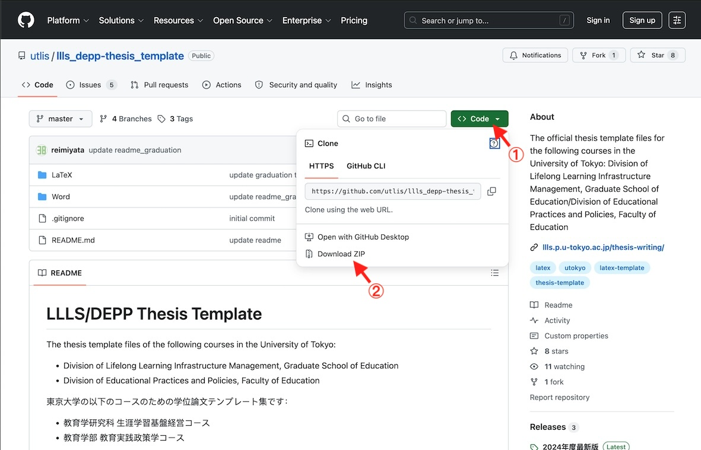

# LLLS/DEPP Thesis Template

The thesis template files of the following courses in the University of Tokyo:

- Division of Lifelong Learning Infrastructure Management, Graduate School of Education
- Division of Educational Practices and Policies, Faculty of Education

東京大学の以下のコースのための学位論文テンプレート集です：

- 教育学研究科 生涯学習基盤経営コース
- 教育学部 教育実践・政策学コース

本テンプレート集は現段階では日本語で執筆する学生を対象としています（英語版は製作中）。
以下、READMEも日本語で記述します。

## Contents

本テンプレートはLaTeXとWordの2種類が含まれています。
学位論文の執筆においてはどちらを利用しても構いません（体裁は同じになります）。
が、強く **LaTeX** を利用した執筆を推奨します。

ZIPファイルのダウンロード方法は下図参照。



対応するフォルダに当該形式のテンプレートが入っています。
テンプレートはそのまま執筆要綱を兼ねていますので、よく読んで執筆を進めてください。

`graduation_thesis` は卒業論文、`master_thesis` は修士論文のテンプレートです。
LaTeX版にはコンパイル済みのPDFも含まれています。

```{}
├── LaTeX
│   ├── graduation_thesis.pdf
│   ├── graduation_thesis.tex
│   ├── master_thesis.pdf
│   ├── master_thesis.tex
│   ├── readme-graduation.txt
│   ├── readme-master.txt
│   └── test.eps
├── README.md
└── Word
    ├── graduation_thesis.docx
    ├── master_thesis.docx
    ├── readme-graduation.txt
    └── readme-master.txt
```

### Overleaf（オンラインLaTeX環境）を利用する場合

LaTeXの環境構築が不要で、ブラウザ上で学習・執筆・コンパイルが可能な **Overleaf** 向けの卒論テンプレートも用意しています。

- [Overleaf版 卒論テンプレート](https://www.overleaf.com/read/zmtcqznpzkst#da7f1d)

こちらのリンク先は直接編集できないため、ご自身で利用される場合は以下の手順でプロジェクトを自分のアカウントにコピーしてください。

1. Overleafのアカウントを作成し、ログイン状態にする。
2. 上記のテンプレートリンクを開いた後、一旦ホーム画面に戻り、該当プロジェクトをコピー（Copy）する。

**執筆時のアドバイスと注意点**

- Overleaf上で直接執筆およびコンパイルが可能です。
- または、執筆自体はご自身のPC上で行い、そのテキストをOverleafの画面に貼り付けてコンパイルする、という使い方も可能です。
- **【重要】** いずれの方法でも、テキストのデータはOverleaf上だけに残すのではなく、ご自身のPC等にも**複数箇所で頻繁にバックアップをとる**ようにしてください。

## Licence and Contribution

ライセンスや使用上の注意は、各フォルダの `readme` ファイルをご参照ください。

現在、[`next-gen`](https://github.com/utlis/llls_depp-thesis_template/tree/next-gen) ブランチで次世代のテンプレートを開発中です。
文系領域の学位論文に使えるLaTeXテンプレートとしてのスタンダードたることを目指しておりますので、こちらにご協力いただける方のご意見・PRをお待ちしております。
